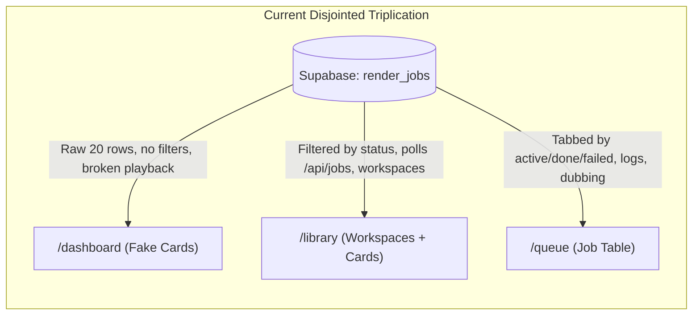
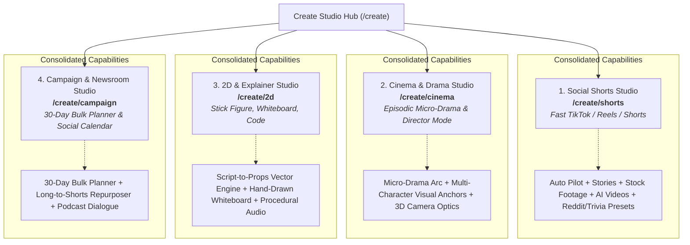
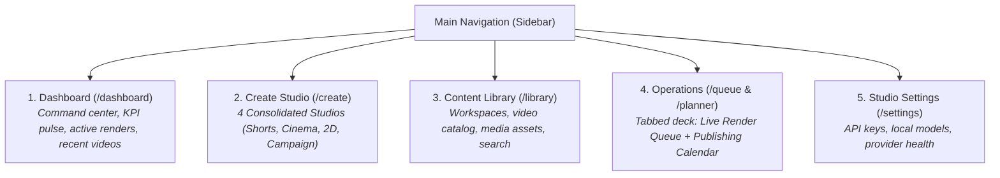

# EGM Design Review: Platform Information Architecture, Workflow Rationalization & Studio Dashboard Overhaul

* **Target System:** Clipped AI Studio ([`app/(app)`](file:///c:/Users/vigilare/.gemini/antigravity/scratch/clipped/app/(app)))
* **Author:** Antigravity (Advanced Agentic Architecture Swarm)
* **Status:** PROPOSED FOR IMPLEMENTATION
* **Date:** 2026-11-03
* **Audit Methodology:** Elephant-Goldfish Model (EGM) Adversarial Architecture & UX Audit

---

## 1. Executive Summary & Adversarial Verdict

### OVERALL VERDICT: REJECTED CURRENT LAYOUT (CRITICAL OVERHAUL REQUIRED)

Clipped AI Studio contains world-class video generation primitives—including an enterprise TTS engine with keyless fallback cascades ([`lib/engine/tts.ts`](file:///c:/Users/vigilare/.gemini/antigravity/scratch/clipped/lib/engine/tts.ts)), deterministic 2D vector procedural animation ([`lib/engine/2d-studio/`](file:///c:/Users/vigilare/.gemini/antigravity/scratch/clipped/lib/engine/2d-studio/)), FFmpeg zoompan camera movement compilers ([`lib/engine/shot-planner.ts`](file:///c:/Users/vigilare/.gemini/antigravity/scratch/clipped/lib/engine/shot-planner.ts)), and a 248-test passing E2E harness ([`tests/e2e/standalone-runner.js`](file:///c:/Users/vigilare/.gemini/antigravity/scratch/clipped/tests/e2e/standalone-runner.js)).

**However, the platform's user-facing shell and information architecture suffer from severe fragmentation, false affordances, and cognitive paralysis:**

1. **The "Dashboard Mirage" (`/dashboard`)**: The primary landing page claims to be a *"Studio Dashboard to manage, view, and publish your rendered short-form videos"*. In reality, it is a raw 20-row query on `render_jobs` rendered via an unpaginated masonry grid. **Videos cannot be played** (clicking Play opens the Publish modal because `output_url` is not queried), **95% of thumbnails render as blank black boxes** (because the code looks for a legacy property only written by the stock footage workflow), and **progress bars are hardcoded simulations** (`w-[60%] animate-pulse`).
2. **The "Workflow Sprawl" (`/create/*`)**: The platform has accumulated **26 backend workflow API routes** and **over 20 distinct creation sub-routes**. A creator visiting `/create` is overwhelmed with a disconnected grid of 20+ cards with mismatched UI patterns (some are 5-step wizards, some are split-screen studios, some are 1-page forms, and some are non-functional stubs).
3. **Severe Information Overlap & Cannibalization**: `/dashboard`, `/library`, and `/queue` all query the exact same `render_jobs` table and present it in three slightly different, conflicting formats, leaving users bewildered about where to monitor jobs, where to view completed videos, and where to organize workspaces.
4. **Sidebar Cognitive Clutter**: The desktop sidebar exposes **10 top-level menu items** with redundant badges (`New`, `Vault`, `Local`, `Trending`, `AI`, `Live`), elevating developer experiments (`/editor/workflow`, `/models`) to the same primary tier as core creation tools.

---

## 2. Deep Dive on the Dashboard: "Is It What It Says?"

### The Promise vs. The Codebase Reality

| Feature Claimed in UI | Codebase Implementation | Real User Experience | Severity |
|---|---|---|---|
| **"View rendered short-form videos"** | [`app/(app)/dashboard/page.tsx:21-25`](file:///c:/Users/vigilare/.gemini/antigravity/scratch/clipped/app/(app)/dashboard/page.tsx#L21-L25) runs `SELECT * FROM render_jobs`. Does not join with `videos` table or query `output_url`. | Clicking the play button on ANY video fails to play video and instead triggers `setIsPublishOpen(true)` ([`DashboardCard.tsx:145-150`](file:///c:/Users/vigilare/.gemini/antigravity/scratch/clipped/components/dashboard/DashboardCard.tsx#L145-L150)). | 🔴 Critical Blocker |
| **Video Thumbnail Cards** | [`app/(app)/dashboard/page.tsx:46-47`](file:///c:/Users/vigilare/.gemini/antigravity/scratch/clipped/app/(app)/dashboard/page.tsx#L46-L47) extracts `parsed?.videos?.[0]?.thumbnail`. | Property `videos` only exists in legacy `footage` workflow. For `drama`, `stories`, `ai-videos`, `whiteboard`, `stick-figure`, `bulk`, `thumbnail` is `null`. The dashboard displays a sea of blank dark rectangles. | 🔴 Critical Blocker |
| **"Manage Rendering Videos"** | [`DashboardCard.tsx:132-139`](file:///c:/Users/vigilare/.gemini/antigravity/scratch/clipped/components/dashboard/DashboardCard.tsx#L132-L139) renders hardcoded `<div className="w-[60%] animate-pulse" />`. | Fake progress animation shown for all pending/processing jobs regardless of actual percentage (`job.progress`). Planning-only jobs display as "Rendering AI video...". | 🟡 Major |
| **Aspect Ratio Badges** | [`DashboardCard.tsx:124-127`](file:///c:/Users/vigilare/.gemini/antigravity/scratch/clipped/components/dashboard/DashboardCard.tsx#L124-L127) hardcodes `<Smartphone /> 9:16`. | Displays "9:16" badge even on 16:9 widescreen or 1:1 square compositions. | 🟡 Major |
| **Studio Metrics & Overview** | None. Zero KPI cards, zero quota indicators, zero active render counters, zero recent activity feed. | It is not a dashboard; it is a raw unfilterable gallery. | 🟡 Major |

### Why `/dashboard`, `/library`, and `/queue` Collide



* **`/dashboard`**: Shows recent 20 jobs as cards, but cannot filter by status or play video.
* **`/library`**: Shows workspaces, calls `/api/jobs`, and renders the exact same `DashboardCard` component with a mini-queue sidecar.
* **`/queue`**: Shows jobs in a clean tabbed list (`active`, `completed`, `failed`) with progress, error messages, and dubbing actions.

**Conclusion:** Users are completely disoriented because the app has three different pages attempting to answer the question *"Where are my videos and what is currently rendering?"*

---

## 3. Comprehensive Workflow Catalog & Rationalization

### The 26 Workflow Routes vs. 20+ Creation Pages Audit

Currently, `app/api/workflows/` and `app/(app)/create/` contain a sprawling list of routes created across different milestones without a unified taxonomy:

```
app/(app)/create/
├── auto/              (1-click autonomous prompt bar)
├── avatar/            (HeyGen talking head)
├── bulk/              (30-day viral trend planner)
├── character/         (IP-Adapter visual consistency)
├── cinema/            (Director mode with focal lengths)
├── code-video/        (Code snippet animations)
├── drama/             (Micro-Drama serialized series)
├── footage/           (Stock footage video wizard)
├── images/            (AI images Ken Burns wizard)
├── mission/           (Autonomous multi-agent director)
├── outpaint/          (16:9 to 9:16 video expander)
├── podcast/           (2-speaker dialogue podcast)
├── previs/            (3D camera pre-visualization)
├── reddit/            (Reddit story scraper & voiceover)
├── scriptbreak/       (Script breakdown & shot list)
├── shorts/            (Extract shorts from long video)
├── stick-figure/      (2D vector script-to-props animation)
├── trivia/            (Multiple-choice trivia quiz video)
├── url/               (URL to video scraper)
├── v2v/               (Video-to-video restyler)
├── whiteboard/        (Hand-drawn sketch animation)
└── yaml/              (Declarative YAML pipeline editor)
```

### The 4 Consolidated Studio Engines (New Architecture)

Instead of forcing users to choose among 20+ fragmented choices, Clipped must consolidate into **4 Signature Creative Studios**:



---

## 4. User Personas & End-to-End Test Cases

### Persona 1: Alex (Solo Content Creator, TikTok & Reels)
* **Goal:** Turn a 1-sentence finance tip into a 45-second viral vertical video with captions and stock B-roll in under 2 minutes.
* **Current Broken Journey:**
  1. Lands on `/dashboard`, sees empty black boxes. Clicks "Create New Video".
  2. Arrives at `/create`, confused between `Auto Pilot`, `Stories`, `AI Videos`, `Stock Footage`, and `Mission`.
  3. Chooses `Footage`, goes through 5-step wizard. Clicks "Send to Queue".
  4. Redirected to `/dashboard?job=...`. Sees a card with `w-[60%] animate-pulse` saying "Rendering AI video...".
  5. Waits 3 minutes. Job status changes to `completed`. Clicks Play button.
  6. **Bug:** Video does NOT play. PublishModal pops up. Alex is frustrated and leaves.
* **Proposed Optimized Journey:**
  1. Lands on new **Studio Dashboard**, types prompt into hero **Omni-Launchpad**: *"3 Money Habits That Kept Me Broke in My 20s"*.
  2. Selects "Social Shorts" $\to$ 1-click Auto Pilot generates narration, subtitle styling, and stock B-roll.
  3. Previews in-place in 15 seconds. Clicks "Render Video".
  4. Top header shows real-time progress (`RenderQueueIndicator` pulses: *"Generating voiceover 30%... Compiling MP4 80%..."*).
  5. Job finishes. Toast notification appears: *"Video ready!"*.
  6. Video plays immediately in dashboard player with working sound, scrubber, and 1-click download.

---

### Persona 2: Elena (Sci-Fi Filmmaker & Web Series Director)
* **Goal:** Direct a 3-episode serialized cyberpunk noir drama with two persistent characters (Detective Jax and Dr. Vesper).
* **Current Broken Journey:**
  1. Navigates to `/create/drama`. Enters characters and premise.
  2. Submits. In older builds, it navigated to `/dashboard` immediately without storyboard review.
* **Proposed Optimized Journey:**
  1. Enters **Cinema & Drama Studio** (`/create/cinema` or `/create/drama`).
  2. Phase 1 ($\le 15$s): LLM Showrunner plans 3-episode arc with cliffhangers and Pollinations visual avatar cards.
  3. Phase 2 (Storyboard Studio): Elena reviews dialogue lines, adjusts Detective Jax's cybernetic coat visual anchor, and auditions Edge TTS voices.
  4. Clicks "Render All 3 Episodes" $\to$ Dispatches 3 child jobs via `pushDramaSeriesToQueue`.
  5. Monitors progress on Dashboard **Active Operations Deck** or **Render Queue**.

---

### Persona 3: Marcus (Agency Lead Managing 5 Client Brands)
* **Goal:** Generate 30 days of fitness motivation videos for Client "Apex Fitness" and schedule them across TikTok and YouTube.
* **Current Broken Journey:**
  1. Clicks "Bulk Planner" in sidebar. Generates 30 ideas.
  2. Wondering where the videos went: Are they in `/planner` (Calendar)? In `/library` (Workspaces)? In `/queue`?
  3. Sidebar has `Bulk Planner`, `Calendar`, `Render Queue`, and `Library` all separate with no client workspace scoping.
* **Proposed Optimized Journey:**
  1. Enters **Campaign & Newsroom Studio** (`/create/campaign`).
  2. Selects Workspace: *"Apex Fitness"*. Enters niche: *"HIIT & Nutrition"*.
  3. Generates 30 scheduled video drafts.
  4. Seamlessly opens **Content Calendar** (`/planner`) where all 30 posts are slotted onto optimal posting times.
  5. Client assets remain strictly isolated under the "Apex Fitness" workspace folder.

---

### Persona 4: Priya (Educator & Technical Explainer)
* **Goal:** Create an animated 2D stick-figure video explaining "How the Internet Works" with sound effects, using \$0 paid API compute.
* **Current Broken Journey:**
  1. Visits `/create/stick-figure`. Sees 3 confusing toggles: "Script Auto-Director", "Procedural SFX Synthesizer", "Full 2D Studio".
  2. Struggles to understand how whiteboard sketches and stick figures differ.
* **Proposed Optimized Journey:**
  1. Enters **2D & Explainer Studio** (`/create/2d`).
  2. Types script into Script Auto-Director.
  3. The real-time NLP parser extracts beats, characters, vehicles, and 12 vector props (coffee cup, magnifying glass, idea bulb).
  4. Previews live at 24 FPS on client Canvas with browser audio playback.
  5. Exports to offline Remotion/FFmpeg render with zero cloud compute cost.

---

## 5. Existing Test Suite (`standalone-runner.js`) Audit & Blind Spots

The repository's zero-dependency test runner ([`tests/e2e/standalone-runner.js`](file:///c:/Users/vigilare/.gemini/antigravity/scratch/clipped/tests/e2e/standalone-runner.js)) executes 248 tests in 3.2 seconds with a 100% pass rate. 

### Why 248 Passing Tests Allowed the Dashboard Bugs to Exist

1. **Source Regex Assertions vs. Runtime Contract Verification**:
   - Tiers 17, 18, 19, and 20 primarily read source code files via `fs.readFileSync` and execute regex assertions (e.g. `expect(content).toMatch(/orchestration_state/)`).
   - While this prevents schema drift and syntax regressions, **it does not execute real React component rendering or database join simulations**.
2. **Missing Dashboard Data Contract Test**:
   - No test verified what `app/(app)/dashboard/page.tsx` renders when jobs exist in the database.
   - No test asserted that `DashboardCard` receives a non-null `output_url` or a valid thumbnail image URL.
3. **Missing API Route Query Verification**:
   - `app/api/jobs/route.ts` was tested for HTTP 200 return and shape keys (`jobs`, `queued`, `completed`), but no test checked whether `job.thumbnail` or `job.title` were correctly deserialized from `render_jobs.logs`.

---

## 6. The Blueprint: Proposed New Layout & Information Architecture

### A. Streamlined 5-Hub Sidebar Navigation

Consolidate the current 10 noisy sidebar items into **5 intuitive, high-utility hubs**:



* **Removed from Top-Level Sidebar**:
  - `Bulk Planner` $\to$ Merged into `Create Studio` (Studio 4).
  - `Generative Assets` $\to$ Merged as a tab inside `Content Library` (`/library?tab=assets`).
  - `Visual Pipeline` (`/editor/workflow`) $\to$ Moved to `Settings > Advanced Pipelines` or `Cinema Studio`.
  - `Model Manager` $\to$ Moved as a tab inside `Settings` (`/settings?tab=models`).

---

### B. New Unified Studio Dashboard Specification

```
+----------------------------------------------------------------------------------------------------+
|  STUDIO DASHBOARD                                                [ Quick Prompt ]  [ + New Video ] |
+----------------------------------------------------------------------------------------------------+
|                                                                                                    |
|  [ STUDIO PULSE: KPI CARDS ]                                                                       |
|  +--------------------+  +--------------------+  +--------------------+  +--------------------+    |
|  |   ACTIVE RENDERS   |  |  COMPLETED VIDEOS  |  |  SCHEDULED POSTS   |  |   API QUOTA HEALTH |    |
|  |         2          |  |         48         |  |         7          |  |   100% (Keyless)   |    |
|  +--------------------+  +--------------------+  +--------------------+  +--------------------+    |
|                                                                                                    |
|  [ OMNI-LAUNCHPAD: 1-CLICK VIDEO CREATION ]                                                        |
|  +----------------------------------------------------------------------------------------------+  |
|  |  (Sparkles) What video do you want to create today? [ e.g. 3 Facts About Black Holes ] (Go) |  |
|  +----------------------------------------------------------------------------------------------+  |
|  |  [ (1) Social Shorts ]   [ (2) Cinema & Drama ]   [ (3) 2D Explainer ]   [ (4) Bulk Campaign ]  |  |
|                                                                                                    |
|  [ ACTIVE OPERATIONS DECK (Only appears when jobs are queued/rendering) ]                          |
|  +----------------------------------------------------------------------------------------------+  |
|  |  (Loader) "Neon Shadows: Ep 1" -- Rendering Beats (4/8) [==========>          ] 50%  [Cancel] |  |
|  |  (Clock)  "Daily Crypto Update" -- In Queue (#1 in line)                              [Cancel] |  |
|  +----------------------------------------------------------------------------------------------+  |
|                                                                                                    |
|  [ RECENT CREATIONS REEL (Working HTML5 Video Player + Poster Frames) ]   [ Filter: All Workspaces v ] |
|  +------------------------+  +------------------------+  +------------------------+                |
|  | [REAL VIDEO POSTER]    |  | [REAL VIDEO POSTER]    |  | [REAL VIDEO POSTER]    |                |
|  | (>) Click to Play      |  | (>) Click to Play      |  | (>) Click to Play      |                |
|  | 0:45 | 9:16 | AI Video |  | 1:12 | 16:9 | Cinema   |  | 0:30 | 9:16 | Stickman |                |
|  | "Why AI Won't Take..." |  | "Detective Jax: Ep 1"  |  | "Quantum Physics 101"  |                |
|  | [ Edit ] [ Download ]  |  | [ Edit ] [ Download ]  |  | [ Edit ] [ Download ]  |                |
|  +------------------------+  +------------------------+  +------------------------+                |
+----------------------------------------------------------------------------------------------------+
```

### C. Data Contract Fix: `app/api/jobs/route.ts` & `render_jobs.logs` Extraction

To permanently eliminate blank thumbnails and broken video playback, `app/api/jobs/route.ts` and `app/(app)/dashboard/page.tsx` must parse the canonical data stored in `render_jobs.logs`:

```ts
export function extractJobPresentation(job: RenderJobRecord) {
  let logs: any = {};
  try {
    logs = typeof job.logs === 'string' ? JSON.parse(job.logs) : (job.logs || {});
  } catch {}

  // 1. Resolve Title
  const title = job.title 
    || logs.subject 
    || logs.title 
    || logs.input?.title 
    || logs.result?.title 
    || `Video ${job.id.slice(0, 8)}`;

  // 2. Resolve Working Video Output URL
  const outputUrl = job.output_url 
    || logs.outputUrl 
    || logs.videoUrl 
    || logs.result?.outputUrl 
    || (job.status === 'completed' ? `/renders/${job.id}.mp4` : null);

  // 3. Resolve Real Poster Thumbnail
  const thumbnail = job.thumbnail_url
    || logs.thumbnail
    || logs.thumbnailUrl
    || logs.beats?.[0]?.imageUrl
    || logs.result?.episodes?.[0]?.scenes?.[0]?.avatarUrl
    || logs.result?.characterSheetUrl
    || logs.videos?.[0]?.thumbnail
    || getWorkflowFallbackCover(logs.workflow || logs.workflowType || 'auto');

  // 4. Resolve Actual Aspect Ratio
  const aspectRatio = logs.aspectRatio 
    || logs.input?.aspectRatio 
    || logs.result?.metadata?.aspectRatio 
    || '9:16';

  // 5. Resolve Accurate Workflow Name
  const workflowType = logs.workflow 
    || logs.workflowType 
    || logs.input?.genre 
    || 'AI Video';

  return {
    ...job,
    title,
    outputUrl,
    thumbnail,
    aspectRatio,
    workflowType,
  };
}
```

---

## 7. Actionable Implementation Plan

### Target Execution Sequence

1. **Step 1: Data Contract & Deserialization Engine (`lib/engine/job-presentation.ts`)**
   - Create unified helper `extractJobPresentation` to safely parse `render_jobs.logs` for titles, real poster thumbnails, aspect ratios, and working video output URLs.
   - Update `app/api/jobs/route.ts` to use `extractJobPresentation`.

2. **Step 2: Studio Dashboard Transformation (`app/(app)/dashboard/page.tsx`)**
   - Implement **Studio Pulse** KPI counters (Active, Completed, Scheduled, Quota).
   - Implement **Omni-Launchpad** prompt bar leading to the 4 consolidated studio doors.
   - Implement **Active Operations Deck** with real progress percentages and SSE/polling live status.
   - Replace broken `DashboardCard` thumbnail/play logic with a functional HTML5 inline video player and working download/export buttons.

3. **Step 3: Sidebar & Layout Consolidation (`components/sidebar.tsx` & `components/MobileNav.tsx`)**
   - Streamline from 10 items to 5 core hubs (`Dashboard`, `Create`, `Library`, `Operations`, `Settings`).
   - Group Queue and Calendar into a cohesive Operations hub.

4. **Step 4: Creation Hub Categorization (`app/(app)/create/page.tsx`)**
   - Re-organize `/create` into 4 clear studio categories:
     - *Social Shorts Studio*
     - *Cinema & Drama Studio*
     - *2D & Explainer Studio*
     - *Campaign & Newsroom Studio*

5. **Step 5: Testing & Contract Verification (`tests/e2e/standalone-runner.js`)**
   - Add Tier 34 test asserting that `extractJobPresentation` correctly extracts thumbnails and video URLs from all workflow log formats.
   - Verify `pnpm lint:scoped` and `pnpm typecheck` remain clean.
