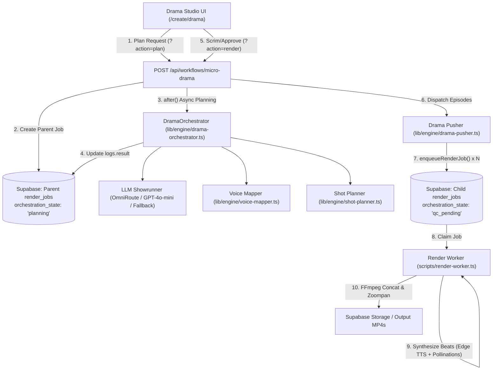

# Micro-Drama Serialized Video Generation Pipeline

* **Author:** Antigravity & User
* **Status:** Approved (Revised Post-Architecture Review Audit)
* **Date:** 2026-11-02
* **Target Version:** Clipped AI Studio v2.4

---

## 1. Executive Overview

This document specifies the technical design for the **AI Micro-Drama Series Generation Pipeline** in Clipped AI Studio ([`app/(app)/create/drama/page.tsx`](file:///c:/Users/vigilare/.gemini/antigravity/scratch/clipped/app/(app)/create/drama/page.tsx)). The pipeline enables creators to produce episodic, serialized narrative video shorts (1 to 10 episodes, 9:16 vertical or 16:9 widescreen) featuring persistent multi-character text prompt anchor prefixing, multi-voice dialogue synthesis, cinematic shot planning, and automated background video compilation.

### Key Architectural Resolutions Post-Architecture Review Audit (Elephant-Goldfish Model / EGM):
1. **Decoupled 1:N Job Hierarchy**: The parent workflow creates an orchestrator job that stays in `orchestration_state: 'planning'` (per `T20-CLAIM-02`), writing the serialized show plan to `render_jobs.logs.result.episodes`. A dedicated pusher ([`lib/engine/drama-pusher.ts`](file:///c:/Users/vigilare/.gemini/antigravity/scratch/clipped/lib/engine/drama-pusher.ts)) dispatches $N$ independent child `render_jobs` records via [`enqueueRenderJob`](file:///c:/Users/vigilare/.gemini/antigravity/scratch/clipped/lib/jobs/enqueue.ts)—one for each episode—with `intent: 'render'` and `orchestration_state: 'qc_pending'`.
2. **Native Worker TTS Reuse**: Replaces hallucinated paths with [`lib/engine/tts.ts`](file:///c:/Users/vigilare/.gemini/antigravity/scratch/clipped/lib/engine/tts.ts) and eliminates server-side audio composition. Dialogue turns map directly onto `RenderBeat` objects (`b.voice`, `b.text`), allowing [`scripts/render-worker.ts`](file:///c:/Users/vigilare/.gemini/antigravity/scratch/clipped/scripts/render-worker.ts) to synthesize per-beat audio natively.
3. **Database Schema Integrity**: Eliminates references to nonexistent `render_jobs.metadata`. All series metadata, character definitions, and episode links are stored in `render_jobs.logs` (JSON).
4. **Two-Phase Interactive Studio**: Transforms `/create/drama` into a 2-phase UI: **Phase 1 (Planning)** generates character avatars and episodic storyboards in $\le 15$ seconds; **Phase 2 (Storyboard Review)** lets creators inspect scripts and audition voices before triggering batch render.
5. **Synchronous Fast-Path Planning & Serverless Compliance**: The planning endpoint (`action=plan`) directly `await`s narrative generation ($\le 15$s) before returning `{ jobId, seriesPlan }`, eliminating race conditions. Unmanaged `setTimeout` is eliminated, and Next.js 16 `after()` is reserved strictly for non-blocking telemetry and metrics.

---

## 2. Problem Statement & Motivation

Short-form episodic drama (TikTok, Reels, YouTube Shorts) is one of the highest-growth video categories, yet existing automated video generators fail to support it due to three structural limitations:

1. **Character Visual Drift Across Cutaways**: Generative text-to-image models drift wildly across scenes. Without explicit prompt-prefix anchoring, facial features, clothing, and hairstyles change with every camera angle.
2. **Monologue Bias vs. Multi-Speaker Dialogue**: Standard short-form workflows assume a single voiceover narrator. Micro-dramas require multi-speaker dialogue between 2 to 6 characters with distinct voice models, emotional inflections, and conversational turn-taking.
3. **Planning vs. Worker Execution Disconnect**: An episode series cannot be compiled as a single video without either concatenating disparate episodes into an unwatchable monolithic file or starving the render worker with empty beats. A structured 1:N orchestration pattern is required.

---

## 3. Goals & Non-Goals

### Goals
* **Persistent Character Visual Anchoring**: Enforce strict text prompt anchor prefixing (attire, physical traits, hair, distinctive accessories) prepended to all scene visual prompts across all episodes.
* **Turn-Based Multi-Voice Audio Mapping**: Assign distinct character voice models (mapped via [`lib/engine/voice-mapper.ts`](file:///c:/Users/vigilare/.gemini/antigravity/scratch/clipped/lib/engine/voice-mapper.ts)) to dialogue beats, synthesized natively by the render worker.
* **Decoupled 1:N Batch Execution**: Orchestrate multi-episode series by keeping the parent plan in `planning` state and spawning independent child `render_jobs` records for each episode via [`enqueueRenderJob`](file:///c:/Users/vigilare/.gemini/antigravity/scratch/clipped/lib/jobs/enqueue.ts).
* **Two-Phase Interactive Studio**: Provide an in-browser Storyboard Studio in `/create/drama` for script inspection, avatar preview, and dialogue review before enqueuing renders.
* **Deterministic Fallback**: Maintain zero-cost, dry-run generation supporting offline development and automated CI testing without requiring paid API keys.

### Non-Goals
* **Granular Scene-Level Cache Invalidation**: Re-rendering individual scenes within an episode is deferred to future iterations; episodes are rendered as atomic units.
* **Real-Time Interactive Fiction / Branching Narrative**: Generation is asynchronous and produces linear episodic videos, not interactive choice-based game trees.
* **3D Virtual Production / Motion Capture**: The engine focuses on 2.5D cinematic keyframes, camera moves (Ken Burns zooms/pans), and dialogue editing, not full 3D skeletal mocap.
* **Long-Form Broadcast TV Runtimes**: Pacing is strictly optimized for vertical micro-dramas (30 to 90 seconds per episode, maximum 10 episodes per series).

---

## 4. Critical User Journeys (CUJs)

### CUJ 1: Two-Phase Series Planning & Batch Render
* **Given**: A creator selects the "Cyberpunk Noir" preset, defines two characters (Detective Jax with a cybernetic coat and Dr. Vesper with a lab coat), selects 3 episodes, and clicks **"Generate Series Storyboard"**.
* **When**: The client calls `POST /api/workflows/micro-drama?action=plan`.
* **Then**: Within $\le 15$ seconds, the system returns a 3-episode arc with cliffhangers and character avatar cards. The UI stays on `/create/drama` and transitions to the **Storyboard Studio Tab**.
* **When**: The creator reviews the lines, auditions dialogue, and clicks **"Render All Episodes"**.
* **Then**: The client calls `POST /api/workflows/micro-drama?action=render`, which dispatches 3 independent child jobs via `pushDramaSeriesToQueue` and redirects to `/dashboard?seriesId=...`.

### CUJ 2: Character Anchor Customization
* **Given**: A creator wants to introduce an antagonist in Episode 2 with a specific visual look.
* **When**: In Phase 1, the creator adds a 3rd character "Cipher" with visual anchor `"hooded black tech-poncho, glowing red visor, scarred jawline"`.
* **Then**: `DramaOrchestrator` embeds Cipher into Episode 2 and 3 scripts and automatically prepends Cipher's visual anchor string into all visual prompts where Cipher is the active speaker or subject.

---

## 5. System Architecture



### Architectural Subsystems

#### A. Two-Phase API Lifecycle & State Machine
The workflow endpoint ([`app/api/workflows/micro-drama/route.ts`](file:///c:/Users/vigilare/.gemini/antigravity/scratch/clipped/app/api/workflows/micro-drama/route.ts)) handles two distinct operations:
1. `action=plan` (Phase 1):
   - Inserts parent `render_jobs` record with `orchestration_state: 'planning'`.
   - Directly `await`s `dramaOrchestrator.generateDramaSeries()` ($\le 15$s planning SLA).
   - Writes the completed series plan to `render_jobs.logs.result`, updates `status: 'completed'`, and returns `{ jobId, seriesPlan }` directly to the client.
   - Leverages Next.js 16 `after()` exclusively for secondary, non-blocking telemetry and metric logging.
2. `action=render` (Phase 2):
   - Receives approved series ID and episode list.
   - Invokes `pushDramaSeriesToQueue(seriesId, episodes, characters)`.
   - Returns `{ success: true, episodeJobIds: string[] }`.

#### B. Showrunner Prompt & Episodic Continuity
* Formulates a three-act micro-arc across episodes:
  * **Episode 1: The Inciting Incident & Tension Hook** (ends on sudden reveal/betrayal).
  * **Episode 2: The Escalation & Point of No Return** (conflicting loyalties).
  * **Episode 3: The Climax & Resolution** (or season finale cliffhanger).
* Assigns `speaker`, `text`, `emotion`, and `listener` to each dialogue turn.

#### C. Text Prompt Anchor Prefixing Engine
Visual prompts are compiled using strict structural templates:
$$\text{Visual Prompt} = \text{"[Character: "} + \text{char.visualAnchor} + \text{"], "} + \text{sceneContext} + \text{", "} + \text{visualStyle}$$
This ensures generative image backends (Pollinations, Fal) lock onto the subject's defining traits without attribute bleeding.

#### D. Voice Mapping Layer ([`lib/engine/voice-mapper.ts`](file:///c:/Users/vigilare/.gemini/antigravity/scratch/clipped/lib/engine/voice-mapper.ts))
Maps user-friendly voice presets to neural TTS model identifiers:

| Voice Preset | Gender | Character Archetype | Microsoft Edge / Azure Neural Voice | OpenAI Voice | ElevenLabs Voice ID |
|---|---|---|---|---|---|
| `onyx` | Male | Gritty, Stoic, Noir Detective | `en-US-GuyNeural` | `onyx` | `ErXwobaYiN019PkySvjV` |
| `nova` | Female | Confident, Sharp, Professional | `en-US-JennyNeural` | `nova` | `EXAVITQu4vr4xnSDxMaL` |
| `echo` | Male | Calm, Analytical, Narrative | `en-US-ChristopherNeural` | `echo` | `21m00Tcm4TlvDq8ikWAM` |
| `shimmer` | Female | Emotional, Empathetic, Melodramatic | `en-US-AriaNeural` | `shimmer` | `AZnzlk1XvdvUeBnXmlld` |
| `fable` | Male | British, Articulate, Villain | `en-GB-RyanNeural` | `fable` | `CYw3kZ02Hs0563khs1Fj` |

**Worker Synthesis Precedence & Provider Protection**:
To prevent [`scripts/render-worker.ts#L736-L747`](file:///c:/Users/vigilare/.gemini/antigravity/scratch/clipped/scripts/render-worker.ts#L736-L747) from overriding per-character voices or misrouting Edge TTS voices to ElevenLabs when API keys exist on the host:
1. Child jobs enqueued by `drama-pusher.ts` **MUST NOT** include a root-level `voice` property in `logs`. Leaving `logs.voice` undefined ensures `b.voice` governs each beat.
2. Child jobs **MUST** explicitly set `voiceProvider: 'keyless'` in `logs` when Edge neural voices are used, preventing the worker's key-sensing fallback from defaulting to ElevenLabs or Google TTS.

#### E. Closed Camera Move & Shot Framing
Conforms strictly to [`lib/engine/shot-planner.ts`](file:///c:/Users/vigilare/.gemini/antigravity/scratch/clipped/lib/engine/shot-planner.ts):
* **Shot Types**: `wide`, `medium`, `close-up`, `macro`, `over-shoulder`.
* **Camera Moves**: `push-in`, `pull-out`, `pan-left`, `pan-right`, `tilt-up`, `tilt-down`, `static`.
* No free-text camera direction strings are permitted.

---

## 6. Data Model & Dictionary

### Database Schema Alignment
* All series-level metadata is stored in `render_jobs.logs` (PostgreSQL `JSONB`/`JSON`).
* No schema migration or `render_jobs.metadata` column is used.

### Data Dictionary

#### Table 1: `DramaCharacter`
| Field | Type | Required | Description |
|---|---|---|---|
| `id` | `string` | Yes | Unique identifier (e.g. `char_jax`). |
| `name` | `string` | Yes | Display name of the character. |
| `visualAnchor` | `string` | Yes | Comma-separated defining physical traits, wardrobe, and facial features. |
| `voice` | `string` | Yes | Voice model slug (e.g. `onyx`, `nova`). |
| `avatarUrl` | `string` | No | Pre-generated visual preview avatar URL (defaults to deterministic Pollinations AI prompt URL during Phase 1). |

#### Table 2: `DramaScene`
| Field | Type | Required | Description |
|---|---|---|---|
| `id` | `string` | Yes | Unique scene identifier (e.g. `ep-1-s1`). |
| `speaker` | `string` | Yes | Name of character speaking or "Narrator". |
| `dialogue` | `string` | Yes | Spoken dialogue text for this scene turn. |
| `visualPrompt` | `string` | Yes | Full anchor-prefixed prompt for image generator. |
| `shotType` | `ShotType` | Yes | One of `wide`, `medium`, `close-up`, `macro`, `over-shoulder`. |
| `cameraMove` | `CameraMove` | Yes | One of `push-in`, `pull-out`, `pan-left`, `pan-right`, `tilt-up`, `tilt-down`, `static`. |
| `duration` | `number` | Yes | Duration in seconds (typically 4.0 to 8.0s). |
| `emotion` | `string` | No | Emotional mood tag (e.g. `tense`, `suspenseful`). |

#### Table 3: `DramaEpisode`
| Field | Type | Required | Description |
|---|---|---|---|
| `episodeNumber` | `number` | Yes | 1-based index of the episode in the series. |
| `title` | `string` | Yes | Episode title (e.g. "Episode 1: The Breach"). |
| `cliffhanger` | `string` | Yes | Dramatic tension hook closing the episode. |
| `scenes` | `DramaScene[]` | Yes | Ordered array of scenes comprising the episode. |
| `duration` | `number` | Yes | Total estimated episode duration in seconds. |

#### Table 4: `RenderBeat` (Passed to Child `render_jobs.logs.beats`)
| Field | Type | Required | Description |
|---|---|---|---|
| `text` | `string` | Yes | Spoken line synthesized by TTS worker. |
| `speaker` | `string` | No | Character name for subtitle display. |
| `voice` | `string` | Yes | Neural voice identifier for worker TTS synthesis. |
| `imagePrompt` | `string` | Yes | Prompt for background scene image. |
| `duration` | `number` | Yes | Target beat duration in seconds. |
| `cameraMove` | `CameraMove` | Yes | Verified zoompan camera move token. |
| `shotType` | `ShotType` | Yes | Verified framing token. |

---

## 7. Architectural Trade-Off Analysis

| Architectural Decision | Chosen Strategy | Alternative Rejected | Trade-Off & Rationale |
|---|---|---|---|
| **Episode Execution Model** | Two-tier hierarchy: parent in `planning`, $N$ child jobs in `qc_pending`. | Single monolithic `render_jobs` record for all episodes. | **Advantage:** Preserves worker 1:1 invariant (`${job.id}.mp4`), enables parallel rendering, provides per-episode progress tracking.<br/>**Downside:** Slightly more database rows created. |
| **Speech Audio Synthesis** | Per-beat TTS synthesis in background worker via `b.voice`. | Monolithic multi-voice WAV compositing in Next.js API route. | **Advantage:** Eliminates API timeout risk; guarantees visual shot cuts align with speech audio stems.<br/>**Downside:** Audio is rendered during worker execution rather than pre-auditioned as a full mix. |
| **Character Consistency** | Text prompt anchor prefixing (`[Character: ...]`). | IP-Adapter / FaceID image conditioning. | **Advantage:** Instant, zero-compute-overhead compatibility with Pollinations/SDXL; zero GPU server dependency.<br/>**Downside:** Mild variation in fine facial features compared to heavy LoRA models. |
| **Background Orchestration** | Synchronous Fast-Path Planning + `after()` for telemetry. | Node.js unmanaged `setTimeout(..., 0)`. | **Advantage:** Predictable $\le 15$s planning response to UI; zero dropped tasks in serverless Next.js runtimes.<br/>**Downside:** Requires strict 12s timeout on LLM planning call. |

---

## 8. Non-Functional Requirements (NFRs) & Verification Matrix

| NFR Category | Target Metric | Verification Method | Enforcement Gate |
|---|---|---|---|
| **Planning Latency** | $\le 15$ seconds for 3 episodes (LLM Showrunner). | Automated timing benchmark in unit tests. | Vitest assertion in `test/engine/drama-orchestrator.test.ts`. |
| **Render Latency** | 180–300s per episode on CPU Linode host (P95 $\le 480$s). | Logged timestamp delta in `render-worker.ts`. | Worker telemetry in `logs.metrics` within `LEASE_MS` limit. |
| **Reliability / Claim Safety** | Zero accidental claims of planning-only jobs. | Rule `T20-CLAIM-02` test in runner. | `tests/e2e/standalone-runner.js` (Tier 20). |
| **Deterministic Fallback** | 100% test pass rate with zero network connectivity / no API keys. | Mocked test suite execution. | Vitest offline runner (`test/setup.ts`). |
| **Cost Efficiency** | \$0.00 external compute cost for standard runs. | Keyless provider verification. | Default to Pollinations AI + Edge TTS. |

---

## 9. Security, Privacy & Content Safety

1. **Prompt Injection Sanitization**: User inputs (`genre`, `script`, character descriptions) are stripped of system prompt overrides, delimiter escapes, and XML/markdown framing attacks via `sanitizePromptInput()` before feeding into the LLM showrunner.
2. **Content Moderation**: Script generation adheres to Clipped's standard safety guidelines. Violence and horror micro-dramas are constrained to PG-13 suspense tropes; graphic sexual content and hate speech are strictly filtered by output schema validation.
3. **Voice Cloning & Impersonation Protection**: Voice IDs are restricted to the approved closed vocabulary in `VOICE_PRESETS`. User-supplied custom voice IDs must be verified against the workspace's authorized voice library.
4. **Tenant Isolation**: Tenant scoping is enforced at the application layer via `videos.user_id` when child jobs create video records, with `workspace_id` tracked in `render_jobs.logs.workspace_id`. Background workers access records using scoped database credentials.

---

## 10. Observability & Telemetry

* **Structured Logging**: All drama pipeline operations use the centralized logger ([`lib/logger.ts`](file:///c:/Users/vigilare/.gemini/antigravity/scratch/clipped/lib/logger.ts)) with module tag `drama`:
  ```ts
  const logger = createLogger('drama');
  logger.info('Series planning started', { seriesId, genre, episodesCount });
  logger.error('Episode dispatch failed', { seriesId, episodeNumber, err });
  ```
* **Phase Metrics**:
  * `t_plan_ms`: Milliseconds elapsed during LLM narrative planning.
  * `t_dispatch_ms`: Milliseconds elapsed writing child jobs to Supabase.
  * `t_render_ms`: Milliseconds elapsed per episode in the background worker.
* **Error Classification**:
  * `ERR_DRAMA_INVALID_GENRE`: Missing or malformed genre input.
  * `ERR_DRAMA_EMPTY_CHARACTERS`: No characters defined.
  * `ERR_DRAMA_LLM_TIMEOUT`: LLM showrunner exceeded 12s timeout; fallback engaged.
  * `ERR_DRAMA_DISPATCH_FAILED`: Database error enqueuing child render jobs.

---

## 11. Detailed Implementation Plan

### Target Files to Create / Modify

#### 1. [`lib/engine/voice-mapper.ts`](file:///c:/Users/vigilare/.gemini/antigravity/scratch/clipped/lib/engine/voice-mapper.ts) (Create)
* Implement `resolveVoiceForCharacter(voiceKey?: string): string`.
* Map OpenAI slugs (`onyx`, `nova`, `echo`, `shimmer`, `fable`) to Edge TTS neural voice IDs (`en-US-GuyNeural`, `en-US-JennyNeural`, etc.).

#### 2. [`lib/engine/drama-pusher.ts`](file:///c:/Users/vigilare/.gemini/antigravity/scratch/clipped/lib/engine/drama-pusher.ts) (Create)
* Implement `pushDramaSeriesToQueue(seriesId: string, seriesPlan: DramaSeriesResponse): Promise<string[]>`.
* Loop over `episodes`, map scenes to `RenderBeat[]` using `resolveVoiceForCharacter`, insert a `videos` row for each episode, and call `enqueueRenderJob({ id: childJobId, status: 'queued', intent: 'render', logs: { beats, voiceProvider: 'keyless', ... } })`.
* **Important Worker Contract**: Ensure root `logs.voice` remains undefined and `logs.voiceProvider` is set to `'keyless'` so the worker's per-beat resolution (`requestedVoice = params.voice || orchState.voice || b.voice`) preserves multi-speaker `b.voice` dialogue turn-taking and does not misroute to ElevenLabs.

#### 3. [`lib/engine/drama-orchestrator.ts`](file:///c:/Users/vigilare/.gemini/antigravity/scratch/clipped/lib/engine/drama-orchestrator.ts) (Enhance)
* Update `generateDramaSeries` to map scenes with verified `CAMERA_MOVES` and `SHOT_TYPES` from `lib/engine/shot-planner.ts`.
* Attach character voice IDs to scenes.
* Ensure deterministic dry-run fallback generates valid `RenderBeat[]` arrays with prompt-anchor prefixing.

#### 4. [`app/api/workflows/micro-drama/route.ts`](file:///c:/Users/vigilare/.gemini/antigravity/scratch/clipped/app/api/workflows/micro-drama/route.ts) (Update)
* Implement 2-phase API handling (`?action=plan` vs `?action=render`).
* For `action=plan`: Synchronously `await dramaOrchestrator.generateDramaSeries()`, write to `render_jobs.logs.result`, and return `{ jobId, seriesPlan }`. Use Next.js 16 `after()` exclusively for non-blocking logging.
* For `action=render`: Call `pushDramaSeriesToQueue` on approval to dispatch child render jobs.

#### 5. [`app/(app)/create/drama/page.tsx`](file:///c:/Users/vigilare/.gemini/antigravity/scratch/clipped/app/(app)/create/drama/page.tsx) (Enhance)
* Implement Phase 1 $\to$ Phase 2 UI state transition.
* Add **Storyboard Studio Tab** displaying character avatar cards, dialogue lines, and scene prompts.
* Add "Render All Episodes" CTA that triggers batch enqueue and navigates to the dashboard.

#### 6. [`test/engine/drama-orchestrator.test.ts`](file:///c:/Users/vigilare/.gemini/antigravity/scratch/clipped/test/engine/drama-orchestrator.test.ts) (Create)
* Unit tests for character visual anchor prefixing, voice mapping resolution, and dry-run output validity.

#### 7. [`tests/e2e/standalone-runner.js`](file:///c:/Users/vigilare/.gemini/antigravity/scratch/clipped/tests/e2e/standalone-runner.js) (Update)
* Add contract assertions in the runner verifying that micro-drama jobs insert valid claimable orchestration states (`'planning'` for parent, `'qc_pending'` for child jobs) and valid non-empty `beats`.

---

## 12. Open Questions (Resolved)

* **Question 1: Multi-Episode Batching vs. Episode-by-Episode Render**:
  * *Resolution*: Resolved in favor of parallel independent child jobs. Creators approve the full storyboard in Phase 2, and the pusher spawns $N$ child jobs. Users monitor progress in `/dashboard`.
* **Question 2: Image Consistency Strategy**:
  * *Resolution*: Resolved in favor of prompt anchor prefixing (`[Character: ${visualAnchor}]`). IP-Adapter/FaceID support will be evaluated as an optional enhancement when dedicated GPU nodes are provisioned.
